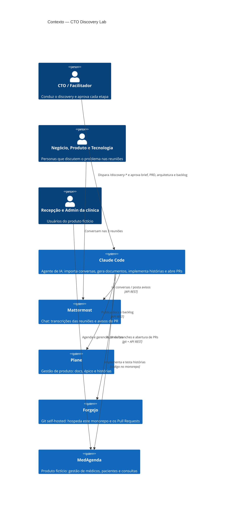
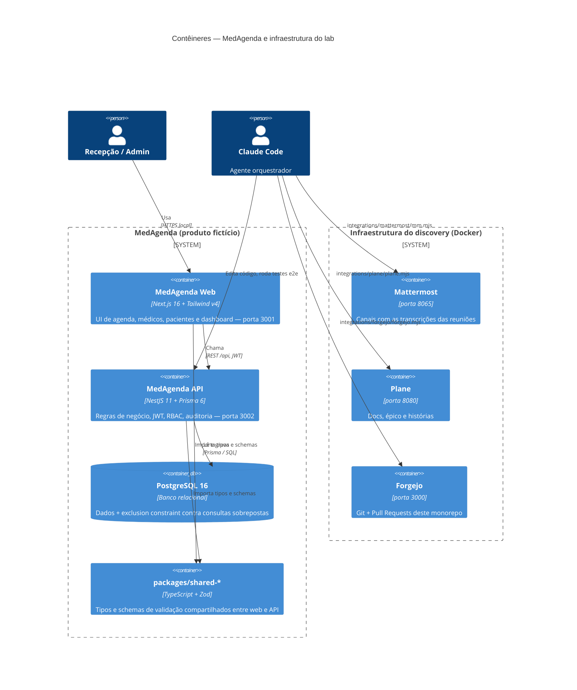
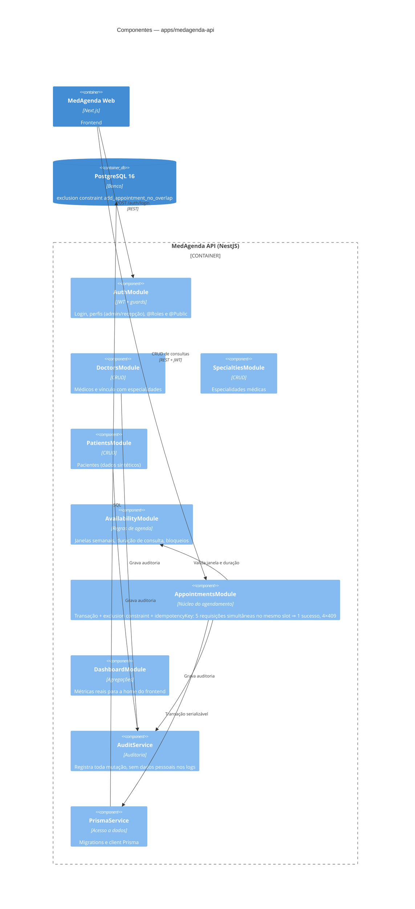

# CTO Discovery Lab

> **Da conversa de negócio ao Pull Request** — discovery estruturado, decisões
> rastreáveis e engenharia assistida por agentes, rodando 100% em `localhost`.

## O que é isto?

Um laboratório de **engenharia agêntica** que demonstra o ciclo completo de
produto, de ponta a ponta:

1. Pessoas de **Negócio**, **Produto** e **Tecnologia** conversam no **Mattermost**;
2. O **Claude Code** importa as conversas e gera síntese, **Product Brief**,
   **PRD** e **arquitetura** usando o [BMAD Method](https://bmadcode.com);
3. O backlog (épico + histórias) é publicado no **Plane**;
4. Uma história aprovada vira **código real** no produto fictício **MedAgenda**,
   com testes e **Pull Request** no **Forgejo** — nunca mergeado automaticamente.

Todos os dados são **sintéticos**. Cada etapa tem **ponto de aprovação humana**.

## Começo rápido

Pré-requisitos: Docker (Compose v2), Node.js ≥ 20, Git, bash (no Windows, Git Bash).

```bash
./lab.sh bootstrap   # instala, sobe tudo, provisiona e publica as transcrições
./lab.sh start       # sobe containers + apps (após o primeiro bootstrap)
./lab.sh seed        # migrations + dados de exemplo do MedAgenda
./lab.sh verify      # checklist completo com evidências em output/evidence/
./lab.sh panel       # painel de controle no navegador → http://localhost:3999
```

Outros: `stop`, `status`, `reset [--yes]` (apaga volumes), `backup` (dump dos bancos).

| Serviço | URL | Papel |
|---|---|---|
| **MedAgenda Web** | http://localhost:3001 | Produto fictício: gestão de clínicas (Next.js) |
| **MedAgenda API** | http://localhost:3002/api | Backend NestJS + Prisma + PostgreSQL |
| **Mattermost** | http://localhost:8065 | Conversas de Negócio/Produto/Tecnologia |
| **Plane** | http://localhost:8080 | Docs, épicos e histórias |
| **Forgejo** | http://localhost:3000 | Git + Pull Requests (hospeda este monorepo) |

## Arquitetura (modelo C4)

### Nível 1 — Contexto

Quem usa o quê. O Claude Code é o agente que atravessa os quatro sistemas;
só a inferência do modelo sai da máquina — todo o resto é local.



### Nível 2 — Contêineres

O que roda dentro de cada sistema. MedAgenda é o produto; os demais são a
infraestrutura do fluxo de discovery (Docker Compose em `infrastructure/`).



### Nível 3 — Componentes da MedAgenda API

Um módulo NestJS por domínio (`module` + `service` + `controller` + DTOs).
Toda mutação grava auditoria; rotas protegidas por perfil via `@Roles(...)`.



### A esteira de discovery (fluxo)

```mermaid
flowchart LR
    MM[("Mattermost<br/>3 reuniões")] -->|/discovery-importar| S["Síntese<br/>com evidências"]
    S -->|/discovery-brief| B["Product Brief<br/>(BMAD Analyst)"]
    B -->|aprovação ✋| P["PRD<br/>(BMAD PM)"]
    P -->|aprovação ✋| A["Arquitetura<br/>AS-IS / TO-BE + ADRs"]
    A -->|aprovação ✋| K["Backlog<br/>épico + histórias Gherkin"]
    K -->|aprovação ✋ /discovery-publicar| PL[("Plane")]
    PL -->|/discovery-implementar| IMP["Código + testes<br/>no MedAgenda"]
    IMP --> PR[("PR no Forgejo<br/>+ aviso no Mattermost")]

    style MM fill:#2563eb,color:#fff
    style PL fill:#7c3aed,color:#fff
    style PR fill:#16a34a,color:#fff
```



| Comando | Faz |
|---|---|
| `/discovery-importar` | Lê as conversas do Mattermost e gera síntese com evidências |
| `/discovery-brief` | BMAD Analyst → Product Brief |
| `/discovery-prd` | BMAD PM → PRD com requisitos de ID estável |
| `/discovery-arquitetura` | AS-IS (código real), TO-BE e ADRs |
| `/discovery-backlog` | Épico + histórias com critérios Gherkin |
| `/discovery-publicar` | Publica docs e backlog no Plane |
| `/discovery-implementar` | História do Plane → branch → testes → PR no Forgejo → aviso no Mattermost |
| `/discovery-completo` | Esteira completa com pontos de aprovação |
| `/discovery-novo-caso <tema>` | Gera um caso inédito (3 reuniões simuladas sobre outro tema) e roda a mesma esteira |

Artefatos gerados ficam em `output/` (síntese, brief, PRD, arquitetura, backlog,
evidências de teste). Cada conclusão cita **canal/autor/timestamp** da transcrição.

## O produto fictício: MedAgenda

Gestão de clínicas com médicos, especialidades, pacientes, disponibilidade
(regras semanais, duração de consulta, intervalos e bloqueios), agendamento com
**proteção contra conflitos concorrentes** (transação + exclusion constraint no
PostgreSQL + idempotência) e dashboard com dados reais do backend.

**Limitações intencionais do AS-IS** (é daqui que o discovery parte): sem lista
de espera, sem reaproveitamento de horários cancelados, sem notificações, sem
sugestão de remarcação, sem confirmação antecipada.

### Testes

```bash
npm run test --workspace apps/medagenda-api        # unitários
npm run test:e2e --workspace apps/medagenda-api    # 22 testes, inclui:
# - CONCORRÊNCIA: 5 requisições simultâneas no mesmo slot => 1 sucesso, 4×409
# - IDEMPOTÊNCIA: mesma idempotencyKey => mesma consulta
# - bloqueios de agenda, cancelamento, auditoria, RBAC
```

## Estrutura do monorepo

```
apps/medagenda-web        Frontend (Next.js 16, Tailwind v4, estilo shadcn/ui)
apps/medagenda-api        Backend (NestJS 11, Prisma 6, PostgreSQL 16)
packages/shared-types     Tipos TypeScript compartilhados
packages/shared-validation Schemas Zod compartilhados
infrastructure/           docker-compose (Postgres+Mattermost+Forgejo) e Plane
integrations/             CLIs: mattermost/, forgejo/, plane/
demo/transcripts/         As 3 reuniões fictícias (~1.000 palavras cada)
_bmad/ + .claude/skills/  BMAD Method v6 (instalação oficial, módulo BMM)
.claude/commands/         /discovery-* (a esteira deste laboratório)
output/                   Artefatos do discovery + evidências
.lab-state/               Tokens gerados em runtime (fora do Git)
lab.sh                    bootstrap | start | stop | status | seed | verify | reset | backup
```

## Credenciais (somente laboratório — dados fictícios)

- **MedAgenda**: `admin@medagenda.local` / `admin123` (também `recepcao@…/recepcao123`)
- **Mattermost**: `sysadmin` / `Sysadmin123!`
- **Forgejo**: `labadmin` / `Labadmin123!`
- **Plane**: `discovery@medagenda.local` / `DiscoveryLab2026!`

Tokens de API gerados pelo bootstrap ficam em `.lab-state/` (fora do Git).

## Segurança e privacidade

Sistema **fictício** com dados sintéticos. Mesmo assim aplica práticas reais:
autenticação JWT, autorização por perfil, validação de entrada (whitelist),
auditoria de operações, idempotência, proteção de concorrência no banco e
segredos fora do Git. O arquivo `output/architecture/as-is.md` separa o que é
demonstrativo do que seria exigido em produção (TLS, cookies httpOnly, LGPD,
retenção, backup, observabilidade).

## Roteiro de demonstração

Ver [DEMO.md](DEMO.md) — roteiro de 20 minutos em 7 atos.
