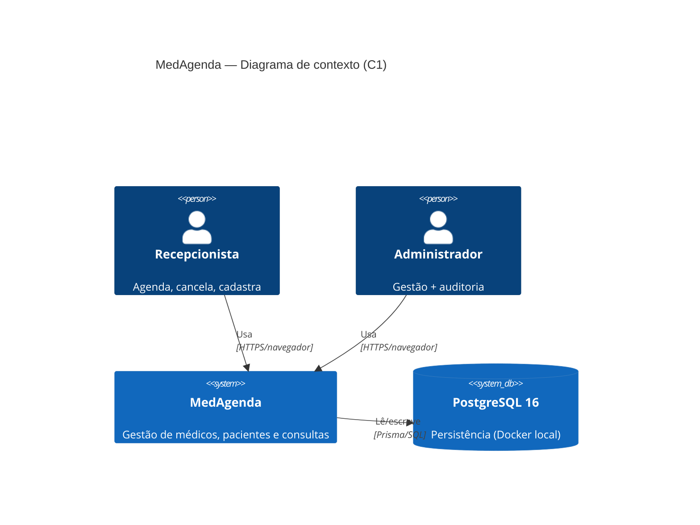
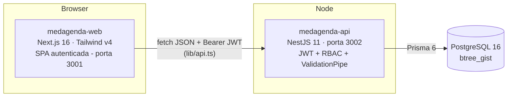
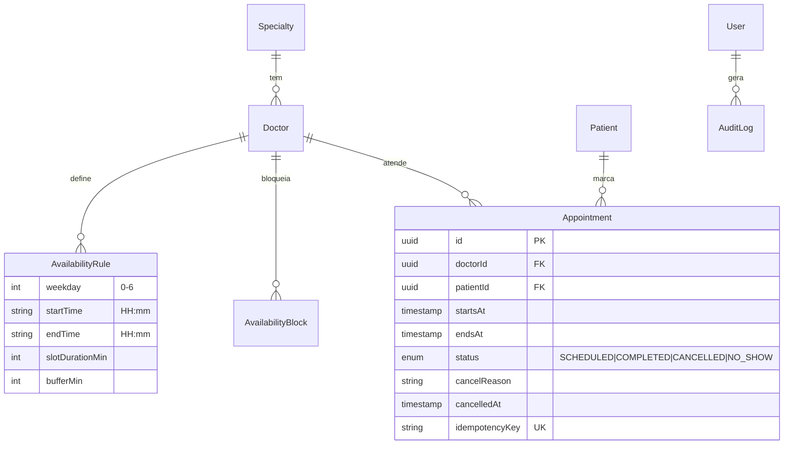
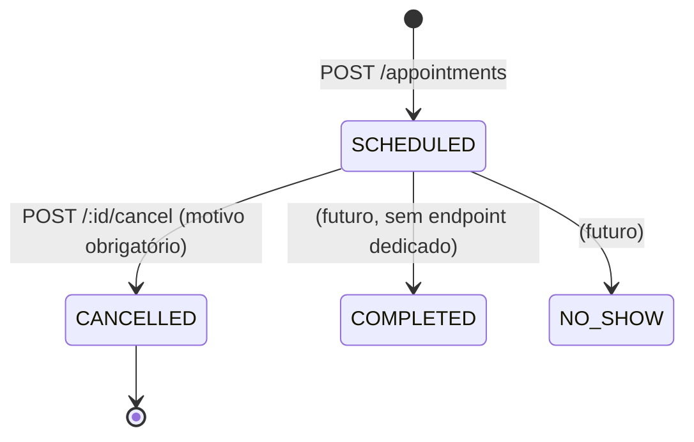
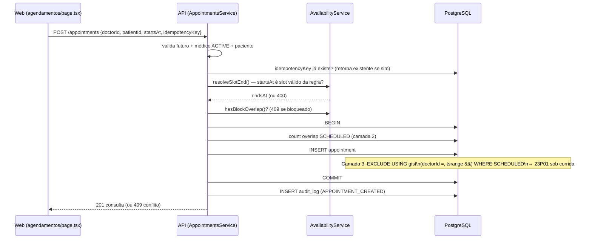

# Arquitetura AS-IS — MedAgenda

Documento gerado a partir da análise do código em `apps/medagenda-api` e
`apps/medagenda-web` (não de memória). Referências apontam para arquivos reais.

## C1 — Contexto



Não há integrações externas no AS-IS: sem e-mail, sem SMS, sem webhook — um
cancelamento termina em si mesmo (motivador do discovery).

## C2 — Contêineres



| Contêiner | Stack | Observações |
|---|---|---|
| `medagenda-web` | Next.js 16 (App Router), páginas client-side, componentes estilo shadcn/ui | Autenticação via JWT em `localStorage` (`lib/api.ts`) — adequação de laboratório, ver §Produção |
| `medagenda-api` | NestJS 11, Prisma 6, class-validator, `@nestjs/jwt` | Guards globais: `JwtAuthGuard` + `RolesGuard` (`src/app.module.ts`) |
| PostgreSQL | 16-alpine (Docker) | Extensão `btree_gist` para exclusion constraint |

## Módulos da API (NestJS)

```
src/
├── auth/            JWT, @Public, @Roles, RolesGuard
├── specialties/     CRUD simples
├── doctors/         CRUD + desativação lógica (status INACTIVE)
├── patients/        CRUD (dados fictícios)
├── availability/    Regras semanais + bloqueios + cálculo de slots
├── appointments/    Agendar / listar / cancelar (núcleo)
├── dashboard/       Agregações do dia
├── audit/           AuditService.record() — trilha de mutações
└── prisma/          PrismaService global
```

## Modelo de dados (prisma/schema.prisma)



## Estados da consulta



O cancelamento (`appointments.service.ts#cancel`) grava `cancelReason` e
`cancelledAt`, audita e **termina aí** — nenhum evento, lista ou notificação.

## Fluxo: agendar consulta (sequence)



## Mecanismos de consistência existentes (reusar, não recriar)

1. **Validação de slot** contra regras de disponibilidade
   (`availability.service.ts#resolveSlotEnd`).
2. **Checagem transacional** de sobreposição dentro de `$transaction`
   (`appointments.service.ts#create`).
3. **Exclusion constraint** no banco — garantia final sob concorrência
   (migration `20261107015222_add_appointment_no_overlap`):
   ```sql
   ALTER TABLE "appointments" ADD CONSTRAINT appointments_no_overlap
   EXCLUDE USING gist ("doctorId" WITH =, tsrange("startsAt","endsAt") WITH &&)
   WHERE (status = 'SCHEDULED');
   ```
   Violação (23P01) → HTTP 409. Comprovado por teste e2e: 5 requisições
   simultâneas no mesmo slot ⇒ 1×201 + 4×409
   (`test/appointments.e2e-spec.ts`).
4. **Idempotência**: `idempotencyKey` única; reenvio retorna a consulta criada.
5. **Auditoria**: mutações gravam `audit_logs` (ação, entidade, usuário), sem
   dados clínicos no payload (`audit.service.ts`).

## Segurança (AS-IS)

- JWT com expiração; guards globais; RBAC por `@Roles` (ADMIN/RECEPCAO/MEDICO).
- `ValidationPipe` com whitelist + forbidNonWhitelisted (rejeita campo extra).
- Senhas bcrypt; mensagens de login não revelam existência de e-mail.
- Segredos em `.env` (fora do Git).

## Demonstração × produção real

| Aceitável no laboratório | Exigido em produção |
|---|---|
| JWT em `localStorage` | Cookie httpOnly + CSRF, rotação de refresh |
| HTTP local | TLS em tudo |
| Timezone do host | TZ explícita da clínica + testes de DST |
| Seed com senhas conhecidas | Gestão de segredos (vault), MFA |
| Sem rate limit | Rate limit, lockout, WAF |
| Logs no console | Observabilidade, alertas, retenção LGPD |
| `COMPLETED/NO_SHOW` sem endpoint | Fluxo operacional completo |

## O gap que motiva o TO-BE

Não existe nenhum conceito de demanda reprimida: nenhuma entidade "interesse",
nenhuma reação ao cancelamento, nenhuma visibilidade de quem espera vaga.
Ver `to-be.md`.
