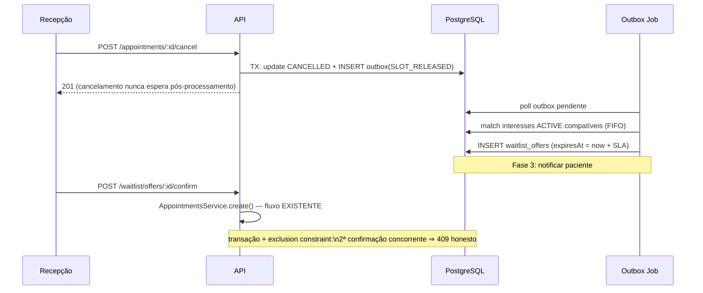

# Arquitetura TO-BE — Lista de espera no MedAgenda

Princípio diretor (da reunião técnica): **reusar o mecanismo de consistência do
agendamento, não recriar** [tecnologia, @bruno, 10:09]. Nada de serviço novo,
mensageria ou IA (ADR-002, ADR-003).

## Visão por fases

```mermaid
flowchart TB
  subgraph F1["Fase 1 — CRUD honesto (este ciclo)"]
    W1[WaitlistModule\ninterests: criar/listar/baixar]
    DB1[(waitlist_interests\nunique parcial ACTIVE)]
    W1 --> DB1
  end
  subgraph F2["Fase 2 — Oferta e confirmação"]
    OB[(outbox_events\nmesma transação do cancelamento)]
    JOB[Job no processo\n(interval) processa outbox]
    OF[(waitlist_offers\ncom expiração)]
    OB --> JOB --> OF
  end
  subgraph F3["Fase 3 — Notificação e métricas"]
    NT[Canal c/ consentimento]
    MX[Métricas de reocupação]
  end
  F1 --> F2 --> F3
```

## Fase 1 — Modelo de dados

```prisma
model WaitlistInterest {
  id            String   @id @default(uuid()) @db.Uuid
  patientId     String   @db.Uuid
  specialtyId   String   @db.Uuid
  doctorId      String?  @db.Uuid          // preferência opcional
  weekdays      Int[]                       // 0-6, mínimo 1 (RN-003)
  periods       String[]                    // MORNING | AFTERNOON
  notes         String?                     // máx. 300, sem dado clínico
  status        WaitlistStatus @default(ACTIVE) // ACTIVE|FULFILLED|CANCELLED|EXPIRED
  resolution    String?                     // motivo da baixa (RN-004)
  appointmentId String?  @db.Uuid           // vínculo quando FULFILLED (RN-006)
  expiresAt     DateTime                    // createdAt + prazo (RN-005)
  createdAt     DateTime @default(now())
  updatedAt     DateTime @updatedAt
}
```

Constraint de unicidade **parcial** (RN-001), via SQL na migration — mesmo padrão
da exclusion constraint existente:

```sql
CREATE UNIQUE INDEX waitlist_active_unique
  ON waitlist_interests ("patientId", "specialtyId")
  WHERE status = 'ACTIVE';
```

### Decisões de consistência da fase 1

- **Expiração lazy** (RN-005): avaliada na consulta (`WHERE`/update oportunista),
  sem job agendado — zero infra nova; job entra na fase 2 junto com o outbox (ADR-004).
- **Concorrência de registro**: duas recepcionistas registrando o mesmo paciente
  na mesma especialidade ⇒ o índice único parcial garante um só `ACTIVE`; a API
  converte a violação em 409 (mesmo padrão de `doctors.service.ts#rethrowUnique`).
- **Autorização**: `@Roles('ADMIN','RECEPCAO')` em todos os endpoints (RF-006).
- **Auditoria**: `WAITLIST_INTEREST_CREATED/FULFILLED/CANCELLED/EXPIRED` sem
  payload clínico (RF-007 / RNF-003).
- **Privacidade**: `notes` documentado como não-clínico; retenção: expirados e
  baixados elegíveis a expurgo (RNF-003).

### API fase 1

| Método | Rota | Perfis | RF |
|---|---|---|---|
| POST | `/waitlist/interests` | ADMIN, RECEPCAO | RF-001, RF-002 |
| GET | `/waitlist/interests?specialtyId&status&weekday&period` | ADMIN, RECEPCAO | RF-003, RF-005 |
| POST | `/waitlist/interests/:id/fulfill` `{appointmentId}` | ADMIN, RECEPCAO | RF-004 |
| POST | `/waitlist/interests/:id/cancel` `{reason}` | ADMIN, RECEPCAO | RF-004 |
| GET | `/waitlist/summary?specialtyId` (contador p/ tela de agendamento) | ADMIN, RECEPCAO | RF-008 |

## Fase 2 — Oferta e confirmação (desenho antecipado)



- Oferta **não trava** a vaga (ADR-001). Confirmação = criar consulta pelo
  caminho padrão; a constraint decide o vencedor sob corrida (RNF-004).
- Outbox = tabela + loop no processo da API (ADR-002). Idempotência do job:
  evento processado marca `processedAt`; reprocessamento é no-op.

## Fase 3 — Notificação e métricas

- Consentimento por canal no cadastro do paciente antes de qualquer envio
  (RF-201); envio fora do request (job do outbox).
- Métricas derivadas dos timestamps já gravados na fase 1 (RF-202): taxa de
  reocupação, tempo cancelamento→reocupação, taxa de resposta a ofertas.

## Segurança/privacidade transversais

| Tema | Tratamento |
|---|---|
| Autorização | RBAC existente; fila restrita a ADMIN/RECEPCAO |
| Privacidade | Interesse = dado sensível: sem payload clínico em auditoria/log; expurgo de expirados; consentimento antes de notificar |
| Idempotência | Chave única parcial (fase 1); outbox idempotente + `idempotencyKey` na confirmação (fase 2) |
| Auditoria | Toda transição de estado auditada com ator |
| Concorrência | Índice único parcial (fila) + exclusion constraint (consulta) |

## Riscos técnicos e dívidas aceitas

- Expiração lazy pode deixar `EXPIRED` "virtual" até a primeira leitura — aceito
  na fase 1 (ADR-004).
- `COMPLETED/NO_SHOW` continuam sem endpoint (fora de escopo do épico).
- Integração da fila na tela de agendamento (RF-008) é requisito de UI da
  fase 1 — sem ela a recepção volta à planilha [tecnologia, @bruno, 10:29].
