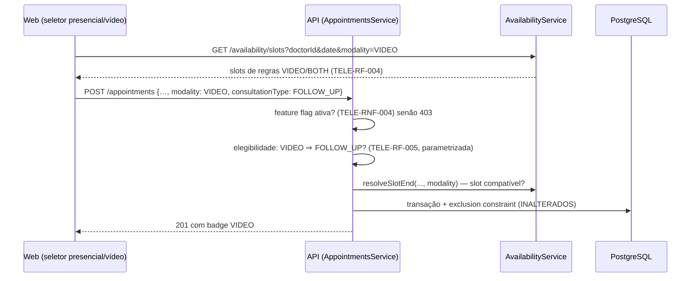

# TO-BE — Telemedicina no MedAgenda

AS-IS de referência: `output/architecture/as-is.md`. O relevante para este
caso, confirmado no código: `Appointment` (schema.prisma) não tem modalidade
nem tipo; `AvailabilityRule` não tem modalidade; o motor de slots
(`availability.service.ts#slotsForDate` / `resolveSlotEnd`) é agnóstico de
lugar — calcula janelas de tempo, nada mais. É a mudança **menos invasiva**
dos três casos: nenhum mecanismo novo de consistência, só uma dimensão nova
atravessando os existentes.

## Fase 1 — Modelo de dados (delta)

```prisma
enum AppointmentModality { IN_PERSON VIDEO }
enum ConsultationType    { FIRST_VISIT FOLLOW_UP }
enum RuleModality        { IN_PERSON VIDEO BOTH }

model Appointment {
  // ... campos existentes ...
  modality         AppointmentModality @default(IN_PERSON)   // TELE-RF-001
  consultationType ConsultationType?                          // TELE-RF-002 (histórico: null)
  videoLink        String?                                    // TELE-RF-006 (fase 1: manual)
}

model AvailabilityRule {
  // ... campos existentes ...
  modality RuleModality @default(IN_PERSON)                   // TELE-RF-003
}
```

Migração indolor: defaults cobrem todo o histórico (TELE-RN-004); nenhuma
constraint nova — a exclusion constraint de não-sobreposição continua valendo
por médico, **independente de modalidade** (um médico não atende dois pacientes
às 10h, seja na sala ou na tela; slot é slot).

## Fase 1 — Fluxo de agendamento com modalidade



Pontos de mudança no código (cirúrgicos):

| Onde | Mudança |
|---|---|
| `availability.service.ts#slotsForDate` | parâmetro `modality`; filtro `rule.modality ∈ {m, BOTH}` |
| `availability.service.ts#resolveSlotEnd` | idem — valida compatibilidade do slot |
| `appointments.service.ts#create` | validações de flag, elegibilidade e modalidade; grava campos novos |
| DTOs | `modality`, `consultationType` (obrigatório), `videoLink` ausente na criação |
| `waitlist` (caso 1) | sem mudança na fase 1; interesse ganha modalidade preferida **só se** o piloto demandar |
| `NO_SHOW` (caso 2) | sem mudança estrutural; motivo sugerido "não conectou" (TELE-RF-008) |

## Fase 1 — Link e privacidade

- `videoLink` com **write/read restrito a ADMIN/RECEPCAO** (RBAC existente);
  excluído de: payloads de auditoria (padrão já praticado), logs e respostas a
  perfis não autorizados (TELE-RNF-001).
- Auditoria registra `VIDEO_LINK_SET` / `VIDEO_LINK_UPDATED` **sem o valor**.
- Fase 1 não gera link: campo manual + ação de cópia na agenda do dia
  (TELE-RF-007).

## Fase 2 — Vídeo como commodity (desenho antecipado)

```mermaid
flowchart LR
  OB[(outbox_events\ncaso 1)] --> JOB[Job de véspera\nmaterializa teleconsultas de amanhã]
  JOB -->|create room idempotente\n(consulta → sala)| PROV[Provedor de vídeo\nsalas efêmeras via API]
  PROV -->|link| AP[(Appointment.videoLink)]
  JOB -->|fase 3| NOTIF[Componente de notificação]
```

- Idempotência: `roomRef` por consulta; reprocessar não duplica sala (TELE-RN-005:
  sala ≤24h antes, expira ≤2h depois).
- Falha do provedor → consulta sinalizada "sem sala" na agenda do dia + plano B
  operacional (TELE-RF-103).

## Fase 3 — Notificação como componente (D8)

Tabela `notifications` (destinatário, canal, template, estado, tentativas,
trilha) + consentimentos: `channelConsent` (reusa a necessidade do caso no-show)
e `telehealthConsent` com versão do termo e timestamp (texto do jurídico — Q5).
Interno ao monolito; e-mail primeiro. Serve aos três casos (ofertas da lista de
espera, lembretes de no-show, links de teleconsulta).

## Segurança/privacidade transversais

| Tema | Tratamento |
|---|---|
| Link = dado sensível por inferência | Fora de logs/auditoria; salas efêmeras não enumeráveis; acesso por perfil (D7) |
| Gate regulatório | Feature flag `TELEMEDICINE_ENABLED` (TELE-RNF-004): deploy ≠ ativação; ativação só com parecer registrado |
| Consentimentos | Dois, distintos, com versão e timestamp (fase 3); aceite verbal documentado no piloto |
| Gravação | Não existe por default (ADR-T03) |
| Concorrência | Nenhum mecanismo novo: exclusion constraint cobre por médico/horário |

## Riscos técnicos e dívidas aceitas

- Testes do motor de slots **dobram de casos** (modalidade × regra) — custo
  aceito e automatizado [tecnologia, @camila, 10:06].
- `consultationType` nullable no histórico: métricas de retorno começam do
  deploy em diante (mesma comunicação do caso no-show).
- Dependência externa nova na fase 2 (provedor) — primeiro ponto de falha fora
  do nosso Docker; plano B operacional obrigatório.
